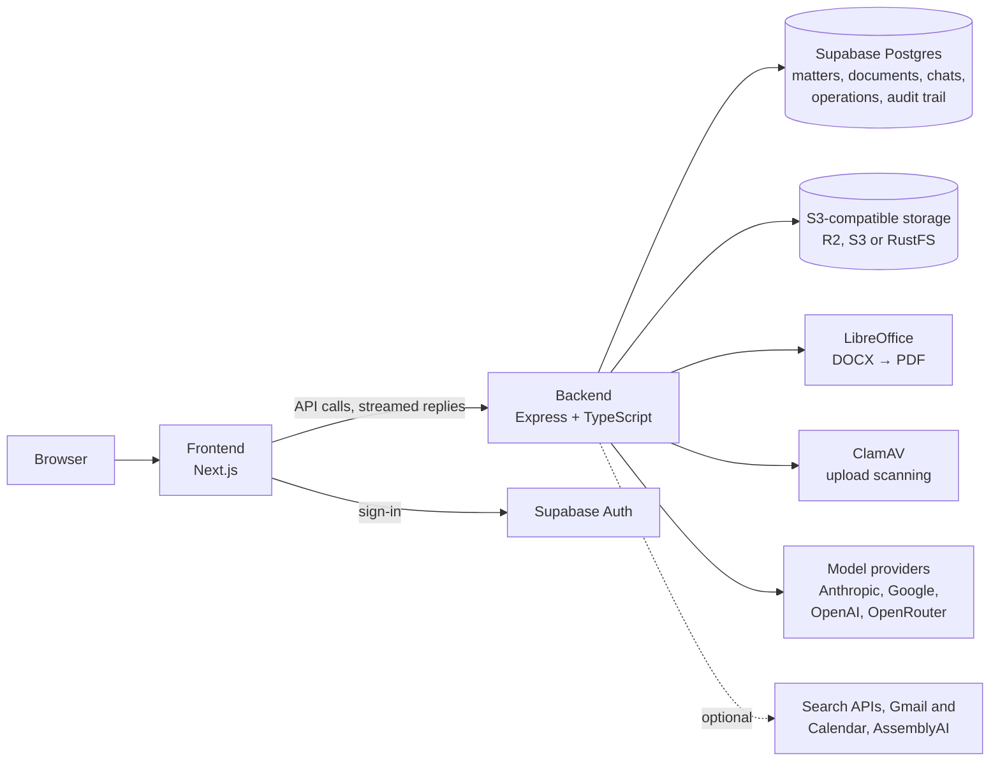
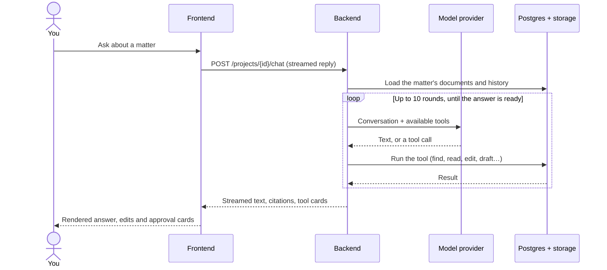
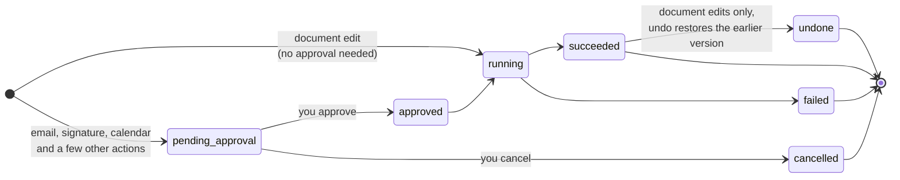
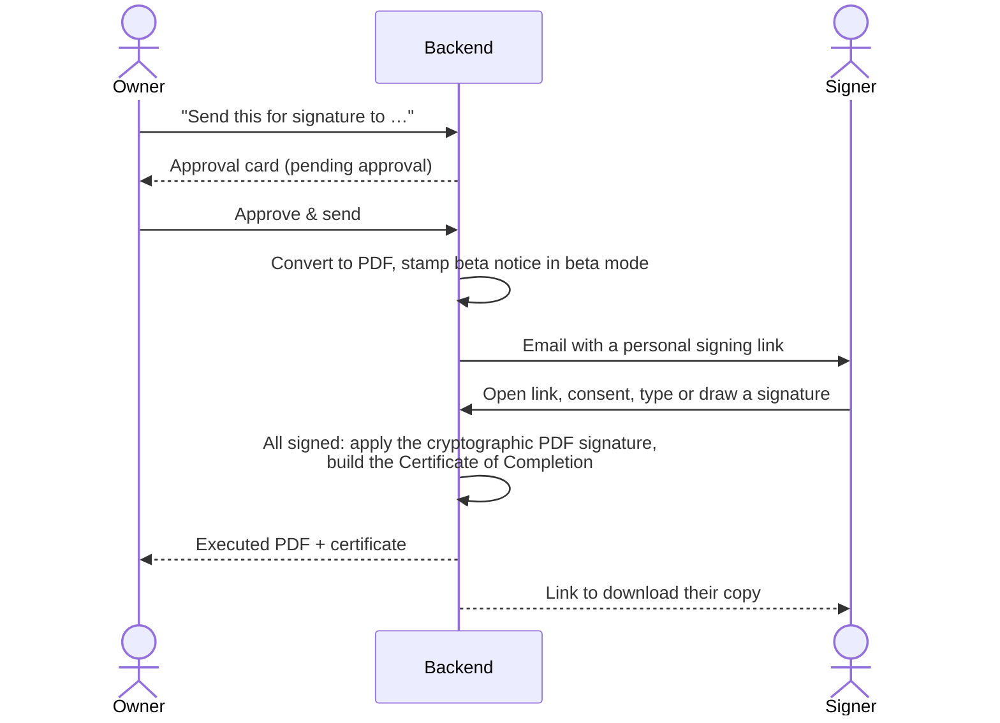
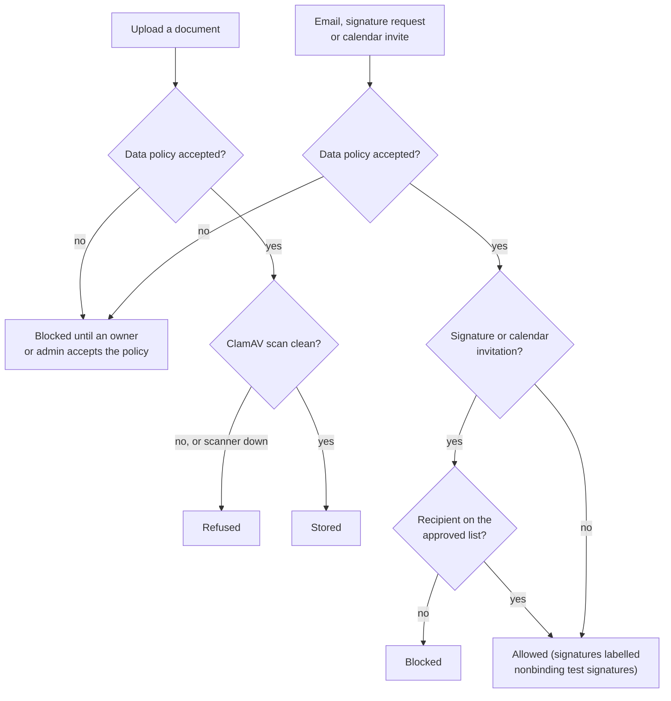
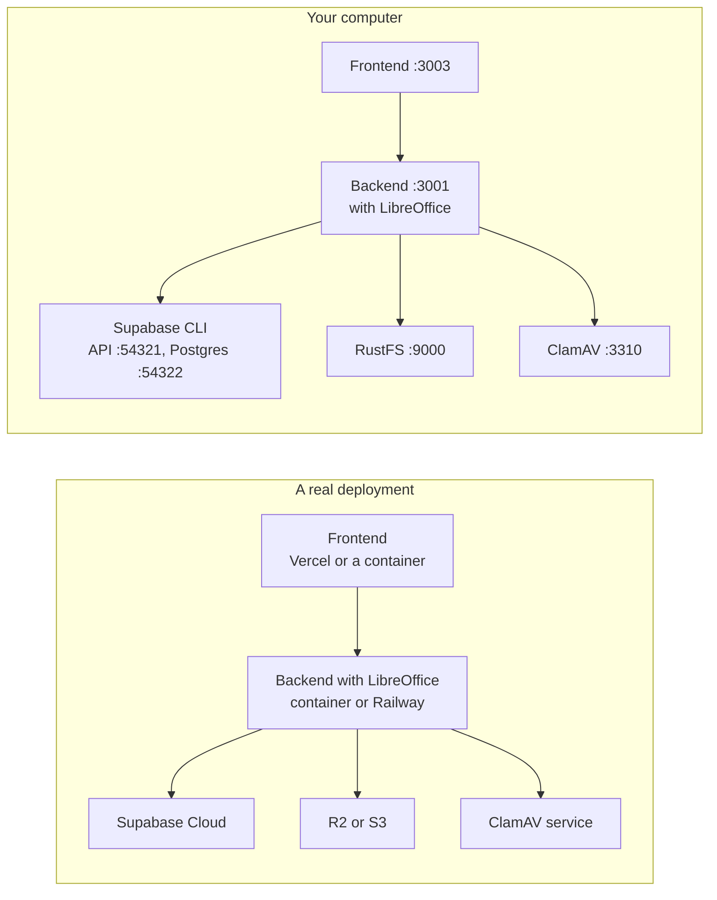

# How Cocoa Legal works

This guide explains the moving parts behind the [README](../README.md) tour: what runs where, what happens when you ask Quill something, how changes are recorded and document edits undone, how e-signature works, and what controlled-beta mode protects. The diagrams are written in [Mermaid](https://mermaid.js.org/), so GitHub draws them and you can edit them as text.

## The pieces

- The **frontend** is a Next.js app. It signs people in through Supabase Auth and talks to the backend over HTTPS with the user's session token.
- The **backend** does the real work. It reads and edits documents, calls models, converts files with LibreOffice, scans uploads with ClamAV and keeps an audit trail in Postgres. Background workers handle document generation, inbound email, calendar reminders and transcription.
- **Storage** holds the files: originals, every version, converted PDFs, signed copies. Files reach the browser through short-lived presigned storage links, or through signed download links that the backend checks before serving the file.
- **Models** are pluggable. Each instance or each user can bring keys for Anthropic, Google, OpenAI or OpenRouter. If a model call fails, the backend can retry it on another model that has a key and is marked verified and healthy; set `MODEL_RUNTIME_FAILOVER_ENABLED=false` to turn that off.

## One question to Quill

Quill answers in a loop of up to 10 rounds. The model can call tools: list the matter's documents, find and read passages, highlight, edit, draft, or prepare an email, calendar invite or signature request. The backend runs each tool and feeds the result back until the model produces an answer, and the text streams to the browser as the model writes it. Citations point to the exact passages it read. Outside a matter, the same loop runs behind `POST /chat`.

## Every change is recorded; document edits can be undone

Each change Quill makes, and each message it prepares, is an **operation** in a ledger, with who asked, what changed and when.

- **Document edits** apply immediately as tracked changes in a new version, so you review them like a colleague's redline. Undo restores the version the edit started from. Only changes to documents can be undone.
- **Anything Quill sends to other people** waits in an approval card until a person approves it: an email, a signature request or a calendar invitation. A few other actions also wait for approval.
- **Versions are never overwritten.** The History view shows every version, which conversation produced it, and any forks.

## E-signature

A signature request moves from `pending_approval` to `sent`, `partially_signed` and `completed`. Cancelling it sets it to `cancelled`. Signing links expire after 14 days by default.

- **The signed PDF** carries a PKCS#7 signature from the deployment's certificate (see [DEPLOY.md](../DEPLOY.md#signing-identity)).
- **The Certificate of Completion** records document hashes, signers, times and consent.
- **Sending needs the Gmail integration.** Without it, Quill can prepare a request, but approving it returns an error and nothing is sent.
- **Not legally reviewed.** The engine has not been reviewed for ESIGN, UETA or eIDAS compliance. See [Responsible use](../README.md#responsible-use).

## Controlled-beta mode

`backend/.env.example` sets `BETA_MODE=true`; if the variable is missing, the safeguards are off. In beta mode:

- Uploads must pass a virus scan.
- An organization owner or admin accepts a data-handling policy before uploads and outbound email.
- Signature and calendar invitations go only to listed addresses or domains.
- Signatures are labelled as nonbinding test signatures.

Set `BETA_MODE=false` to turn these off. Upload scanning stays on while `UPLOAD_SCANNING_REQUIRED=true`.

## What runs where

Locally, Docker Compose runs the frontend, backend, RustFS and ClamAV on `127.0.0.1`, next to the Supabase CLI stack (which listens on every interface with well-known demo keys), so keep it to one machine and test data. A real deployment swaps in managed pieces; [DEPLOY.md](../DEPLOY.md) walks through each one.
